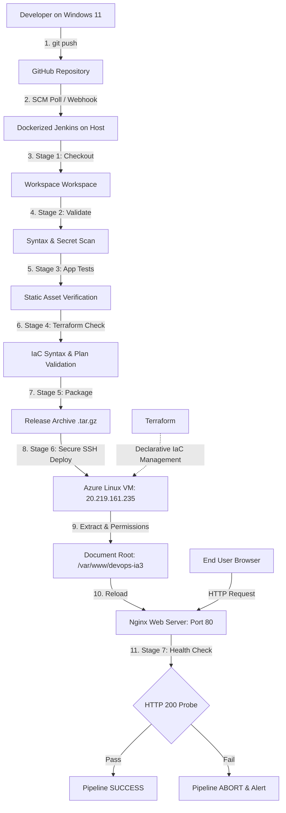

# Automated Deployment of a Web Application Using CI/CD, Terraform, Azure, GitHub, Docker, and Jenkins

**DevOps IA-3 Academic Project**  
**Student Developer:** Francis  
**Target Platform:** Microsoft Azure (Ubuntu 22.04 LTS)  
**Public Application URL:** [http://20.219.161.235](http://20.219.161.235)  
**GitHub Repository:** [https://github.com/francis1103/DevOps-IA3.git](https://github.com/francis1103/DevOps-IA3.git)  

---

## 1. Abstract

Modern cloud-native software engineering relies on automated, repeatable, and secure delivery mechanisms. This project demonstrates an enterprise-grade DevOps Continuous Integration and Continuous Deployment (CI/CD) pipeline for a responsive web application. 

Using **HashiCorp Terraform** for Infrastructure as Code (IaC), **Docker** to containerize a **Jenkins** automation engine, **GitHub** for distributed version control, and **Microsoft Azure** for cloud compute and network infrastructure, this system eliminates manual server management. Code updates pushed to GitHub are automatically tested, validated, packaged, securely transferred via SSH key authentication to an Azure Linux Virtual Machine, and served via an **Nginx** web server.

---

## 2. Problem Statement

Manual deployment workflows suffer from critical shortcomings:
1. **Human Error & Inconsistency:** Manual copying of files, configuration errors, and forgotten server restarts introduce downtime.
2. **Configuration Drift:** Divergence between development, testing, and production environments causes unpredictable bugs.
3. **Security Vulnerabilities:** Hardcoded credentials, exposed administrative ports (such as SSH open to `0.0.0.0/0`), and unencrypted secret handling.
4. **Slow Release Cycles:** Lack of automation delays feedback loops and software delivery.

---

## 3. Objectives

- **Codified Infrastructure:** Declare all Azure resources (Resource Group, VNet, Subnet, NSG, Public IP, NIC, and Ubuntu VM) using Terraform.
- **Automated Delivery Pipeline:** Implement a declarative Jenkins Pipeline inside Docker executing automated checkout, validation, testing, and deployment.
- **Strict Security Architecture:** Restrict SSH port 22 access strictly to the administrator's verified public IP while keeping port 80 open for public HTTP evaluation.
- **Zero-Downtime Deployment:** Deploy application code idempotently to `/var/www/devops-ia3` with zero duplicate files and automated Nginx configuration reloads.
- **Automated Health Probing:** Validate HTTP response codes (HTTP 200 OK) immediately following deployment.

---

## 4. Technologies Used

- **Operating System:** Windows 11 (Development Workstation) & Ubuntu 22.04 LTS (Azure VM)
- **Version Control:** Git 2.50.1 & GitHub Remote
- **Containerization:** Docker Desktop & Docker Compose
- **CI/CD Automation:** Jenkins LTS (JDK 21) in Docker
- **Infrastructure as Code:** HashiCorp Terraform v1.10.5
- **Cloud Provider:** Microsoft Azure (Azure for Students Subscription)
- **Web Server:** Nginx 1.18+
- **Frontend Stack:** Semantic HTML5, Modular CSS3 (Dark Theme, Glassmorphism), Vanilla JavaScript

---

## 5. System Architecture

The following diagram illustrates the end-to-end continuous delivery lifecycle:



---

## 6. Project Directory Structure

```text
DevOps_IA3/
├── index.html                   # Production DevOps Deployment Dashboard
├── css/
│   └── style.css                # Modern responsive design tokens & animations
├── js/
│   └── script.js                # Interactive telemetry & mobile navigation
├── terraform/
│   ├── providers.tf             # Terraform & AzureRM provider configuration
│   ├── variables.tf             # Infrastructure variables & CIDR defaults
│   ├── main.tf                  # Declarative Azure resources (RG, VNet, VM, NSG)
│   ├── outputs.tf               # Public IP, SSH command, and HTTP endpoints
│   ├── terraform.tfvars.example # Example variable values (non-secret template)
│   └── README.md                # Infrastructure guide & safe import instructions
├── jenkins/
│   ├── Dockerfile               # Custom Jenkins image with Git, SSH, and Curl
│   ├── compose.yaml             # Docker Compose specification on port 127.0.0.1:8080
│   └── README.md                # Jenkins credentials & job setup guide
├── scripts/
│   ├── validate.sh              # Preflight validation & secret leak scan
│   ├── deploy.sh                # Idempotent SSH deployment script
│   └── health-check.sh          # Automated HTTP 200 response probe
├── Jenkinsfile                  # Root declarative Jenkins Pipeline (7 stages)
├── .gitignore                   # Excludes credentials, keys, and Terraform state
└── README.md                    # Comprehensive academic project documentation
```

---

## 7. Azure Cloud Infrastructure Specifications

| Component | Resource Name | Region | Value / Configuration |
| :--- | :--- | :--- | :--- |
| **Subscription** | Azure for Students | Global | ID: `93311933-4c9a-4885-a12f-31d96826a029` |
| **Resource Group** | `devops-ia3-rg` | `southindia` | Preserved original regional placement |
| **Virtual Network** | `devops-ia3-vnet` | `centralindia` | Address space: `10.0.0.0/16` |
| **Subnet** | `devops-ia3-subnet` | `centralindia` | Address prefix: `10.0.1.0/24` |
| **Network Interface** | `devops-ia3-nic` | `centralindia` | Private IP: `10.0.1.4` (Attached to NSG & Public IP) |
| **Public IP Address** | `devops-ia3-public-ip` | `centralindia` | `20.219.161.235` (Static, Standard SKU) |
| **Virtual Machine** | `devops-ia3-vm` | `centralindia` | `Standard_B2als_v2` (Ubuntu 22.04 LTS) |
| **Admin User** | `azureuser` | — | SSH Key Authentication (`devops_ia3_key`) |

---

## 8. Network Diagnostic & Resolution

### Diagnosing SSH Timeout
During initial testing from the Windows development workstation, connection attempts on TCP port 22 (`Test-NetConnection -ComputerName 20.219.161.235 -Port 22`) timed out, whereas TCP port 80 succeeded.

**Root Cause Analysis:**
- The Network Security Group (`devops-ia3-nsg`) restricts inbound SSH (TCP 22) to the administrator's specific public IP address for security.
- The administrator's public IP address previously was `157.51.77.185`.
- Live inspection via `Invoke-RestMethod https://api.ipify.org` confirmed that the workstation's current public IP is:
  $$\mathbf{14.139.187.145}$$
- Because Azure NSG dropped incoming packets from the new IP address, SSH connections timed out.

### Resolution Steps
To allow SSH access for the administrator and the Jenkins container (which routes through the host's public IP):
1. Authenticate with Azure CLI:
   ```bash
   az login
   ```
2. Update the NSG rule to permit the verified public IP address:
   ```bash
   az network nsg rule update \
     --resource-group devops-ia3-rg \
     --nsg-name devops-ia3-nsg \
     --name Allow-SSH-Inbound-AdminOnly \
     --source-address-prefixes 14.139.187.145
   ```
3. Test SSH connection:
   ```powershell
   ssh -i C:\Users\franc\.ssh\devops_ia3_key azureuser@20.219.161.235
   ```

---

## 9. Local Development & Testing Instructions

### Local Verification
1. Open `index.html` in any web browser to verify responsive layout, mobile navigation, and interactive telemetry controls.
2. Run preflight validation:
   ```bash
   bash scripts/validate.sh
   ```

### Git Repository Setup & Push
```powershell
git init
git remote add origin https://github.com/francis1103/DevOps-IA3.git
git branch -M main
git add .
git commit -m "feat: complete automated CI/CD pipeline, Terraform IaC, and dashboard"
git push -u origin main
```

---

## 10. Jenkins Pipeline Configuration

1. Open Jenkins at `http://127.0.0.1:8080`.
2. Add SSH Private Key Credential:
   - Navigate to **Manage Jenkins → Credentials → System → Global credentials**.
   - Create credential with ID: `azure-vm-ssh-key`.
   - Username: `azureuser`.
   - Private key: Paste contents of `C:\Users\franc\.ssh\devops_ia3_key`.
3. Create a **Pipeline** job named `DevOps-IA3-Pipeline`:
   - Set SCM to **Git** pointing to `https://github.com/francis1103/DevOps-IA3.git`.
   - Branch: `*/main`.
   - Script Path: `Jenkinsfile`.
   - Build Trigger: **Poll SCM** (`H/2 * * * *`).
4. Click **Build Now** to execute the pipeline.

---

## 11. Security & Compliance Review

- **Zero Secret Commits:** Verified `.gitignore` prevents private keys (`devops_ia3_key`), `.env` files, and `terraform.tfstate` from entering Git history.
- **Administrative Port Restriction:** SSH port 22 is strictly restricted to administrator IPv4 addresses.
- **Non-Exposed CI/CD Engine:** Jenkins binds to `127.0.0.1:8080`, preventing internet access to the build engine.
- **Hardened Web Server:** Nginx includes `X-Content-Type-Options: nosniff`, `X-Frame-Options: SAMEORIGIN`, and `X-XSS-Protection`.

---

## 12. Cost & Resource Management (Azure for Students)

To avoid consuming academic credit:
- **Compute SKU:** `Standard_B2als_v2` is an ARM-based/economical burstable VM.
- **Deallocation:** To stop compute billing when not in use, deallocate via Azure CLI:
  ```bash
  az vm deallocate --resource-group devops-ia3-rg --name devops-ia3-vm
  ```
  *(Note: Stopping Ubuntu from inside the OS does NOT release compute charges; Azure deallocation is required.)*
- **Restarting VM:**
  ```bash
  az vm start --resource-group devops-ia3-rg --name devops-ia3-vm
  ```
  *(Because the public IP is Static, the IP address `20.219.161.235` is preserved across restarts).*
